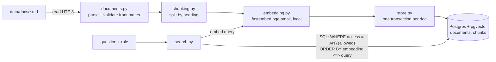

# mini-company-brain

Company knowledge base that compiles docs into an LLM wiki, answers with citations, and exposes tools over MCP.

The company, people and documents are fictional (see [SPEC.md](SPEC.md)).

## Status

| Step | Deliverable | State |
| --- | --- | --- |
| 1 | Spec | Done |
| 2 | Ingest: load, chunk, embed and search the docs | Done (Markdown; PDF is a planned follow-up) |
| 3 to 7 | Wiki compiler, agent Q&A, evals, MCP server, UI | Not started |

## How ingest and search work



1. **Read**: every `.md` file in `data/docs/` must start with YAML front matter (`title`, `date`, `type`, `access`). `access` must be exactly `all` or `hr`; anything else stops the run before anything is written.
2. **Chunk**: each Markdown section becomes a chunk that keeps its source file, full heading path (for example `HR-POL-002 Leave Policy > 2. Annual leave > 2.1 Entitlement`) and access label. Sections over 300 words are split at paragraph breaks.
3. **Embed**: chunks are embedded locally with `BAAI/bge-small-en-v1.5` (384 dimensions) through `fastembed`. No document text leaves the machine.
4. **Save**: each document and its chunks are written in one transaction. Unchanged files are skipped by content hash; files removed from the folder are removed from the database.
5. **Search**: the question is embedded and compared by cosine distance. The access filter is in the SQL `WHERE` clause, so an `employee` search never receives `hr` rows from Postgres.

## Setup

Requirements: [uv](https://docs.astral.sh/uv/), Docker Desktop, Python 3.11 (uv installs it if missing).

```bash
cp .env.example .env          # then fill in POSTGRES_USER, POSTGRES_PASSWORD, POSTGRES_DB
docker compose up -d          # Postgres 17 + pgvector, bound to 127.0.0.1 only
uv sync                       # install dependencies into .venv
```

`.env` is gitignored. Never commit it.

## Usage

```bash
uv run mcb-ingest
```

Loads, chunks, embeds and saves `data/docs/`. The first run downloads the model (about 65 MB) to `.cache/fastembed/` (gitignored; override with `FASTEMBED_CACHE_DIR`). Running it again only processes changed, new or removed files.

```bash
uv run mcb-search "How many days of annual leave does a new hire get?"
uv run mcb-search "What is Aisyah's salary?" --role hr --k 3
```

Prints the closest chunks with score, access label, file and heading. `--role` is `employee` (default, sees `all`) or `hr` (sees `all` and `hr`). It is a developer tool: in the later steps the role comes from the user's token and the database, not from a flag.

## Tests

```bash
uv run pytest                        # everything (needs Docker running and the model cached)
uv run pytest -m "not integration"   # unit tests only, no database or model needed
uv run ruff check .
uv run ruff format --check .
```

Integration tests create a throwaway schema (`test_<random>`) per test or per run and drop it afterwards, so they never touch ingested data. The search tests check that the questions from SPEC.md find the right chunk in the top 3, that an employee never gets an HR chunk, and that HR can find the salary bands.

## Project layout

| Path | Purpose |
| --- | --- |
| `src/mini_company_brain/config.py` | Settings from `.env` (password hidden from `repr`, 5 s connect timeout) |
| `src/mini_company_brain/db.py`, `schema.sql` | Connection and the `documents` / `chunks` tables |
| `src/mini_company_brain/documents.py` | Read files and validate front matter |
| `src/mini_company_brain/chunking.py` | Split documents by heading |
| `src/mini_company_brain/embedding.py` | Local embeddings with fastembed |
| `src/mini_company_brain/store.py` | Save, update and remove documents |
| `src/mini_company_brain/search.py` | Role-filtered vector search |
| `src/mini_company_brain/cli.py` | `mcb-ingest` and `mcb-search` |
| `data/docs/` | The 26 fictional company documents |
| `evals/` | Answer key for the eval set (never ingested) |
| `docs/plans/` | Implementation plans |

## Known limitations

- Markdown only for now. PDF support is planned after Step 2.
- A file is re-chunked only when its text changes. Changing the chunking code needs a manual reset of the tables.
- A `#` line inside a fenced code block would be read as a heading (no current document has code blocks).
- Search returns related chunks, not answers: for "who owns e-Invoice now" the outdated brief can rank above the newer change. Choosing the newest source is the agent's job (Step 4).
- No users table or Row-Level Security yet. Both come in a later step; every chunk already stores its access label.
