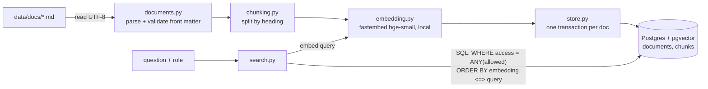

# Step 2d: Ingest Pipeline Implementation Plan

> **How to execute:** Implement one task (part) at a time, directly in the session. Run its tests, explain what was built, and stop for the owner's review before the next task. Steps use checkbox (`- [ ]`) syntax for tracking.

**Goal:** Load the 26 Markdown docs in `data/docs/`, split them into heading-based chunks, embed each chunk locally with `BAAI/bge-small-en-v1.5`, store text, embedding, source file, section heading and access label in Postgres, and prove that a search returns the right chunk and respects the access label.

**Architecture:** A one-shot CLI (`mcb-ingest`) reads every file, validates front matter, chunks by Markdown heading, and only after every file parses does it touch the database. Each document is written in its own transaction (upsert document row, replace its chunks). Search is a single SQL query using pgvector cosine distance with the access filter in the `WHERE` clause, so filtered-out rows never leave Postgres.

**Tech Stack:** Python 3.11, uv, psycopg 3, pgvector (Python adapter), fastembed, PyYAML, python-dotenv, pytest, ruff.

**Spec:** `SPEC.md` (sections 5.1 Ingest, 8 Security "Employee sees HR-only info", 9 Milestone 2).

## Data flow



Trust boundaries: (1) the files in `data/docs/` are untrusted input, so front matter is validated and parsed with `yaml.safe_load`; (2) the role passed to `search` decides what leaves the database, so the filter is in SQL, not in Python after the fetch.

## Global Constraints

- Embedding model: `BAAI/bge-small-en-v1.5` through `fastembed`, vector size **384**, cosine distance (`<=>`).
- Every chunk stores: `source_path` (file name relative to `data/docs/`, for example `policy-hr-002-leave.md`, same convention as `evals/planted_facts.md`), `heading` (full path, for example `HR-POL-002 Leave Policy > 2. Annual leave > 2.1 Entitlement`), and `access` (`all` or `hr`).
- Access label is **fail closed**: anything other than exactly `all` or `hr` (missing, `HR`, `public`) aborts ingest. Never default to `all`.
- Files are read with `encoding="utf-8"` explicitly (Windows default is cp1252).
- DB credentials come only from `.env` (`POSTGRES_USER`, `POSTGRES_PASSWORD`, `POSTGRES_DB`, `POSTGRES_PORT`). Never logged.
- Model cache lives on D: in `.cache/fastembed/` inside the project (already gitignored by `.cache`), overridable with `FASTEMBED_CACHE_DIR`.
- Only Markdown in this step. `evals/` is never read by ingest.
- All repo text in English, no em dashes. Ask before installing, deleting, or committing.

## Review Focus

1. A doc whose `access` is missing or mistyped (`HR`, `Hr`, `public`): ingest must stop before writing anything, naming the file. Test in Task 2 and Task 3.
2. Running `mcb-ingest` twice: same row counts, no duplicate chunks. Test in Task 3.
3. A doc edited from `access: all` to `access: hr`: its chunks must become `hr` too (the chunk-level copy must not go stale), so an employee search stops returning it. Test in Task 3.
4. A doc removed from the folder (especially an HR doc): its chunks must stop appearing in search. Test in Task 3 (depends on open question 1).
5. A `---` line inside the body (horizontal rule, the forwarded-email separator): must stay body text, not end the front matter. Test in Task 2.

## File structure

| File | Responsibility |
| --- | --- |
| `src/mini_company_brain/config.py` | Read `.env`, build the DB connection string and model cache path |
| `src/mini_company_brain/db.py` | `connect()`, `apply_schema()` |
| `src/mini_company_brain/schema.sql` | Table definitions (idempotent) |
| `src/mini_company_brain/documents.py` | Read a file, validate front matter, return `Document` |
| `src/mini_company_brain/chunking.py` | Split a `Document` into `Chunk`s by heading |
| `src/mini_company_brain/embedding.py` | `Embedder` protocol and the fastembed implementation |
| `src/mini_company_brain/store.py` | Save documents and chunks, sync the folder |
| `src/mini_company_brain/search.py` | Role-filtered vector search |
| `src/mini_company_brain/cli.py` | `mcb-ingest` and `mcb-search` entry points |
| `tests/unit/...` | No DB, no model. Fast |
| `tests/integration/...` | Need Docker Postgres (marker `integration`); search test also needs the real model |

---

### Task 1 (Part A): Database tables

**Files:**
- Modify: `pyproject.toml` (dependencies, dev group, scripts, pytest marker, ruff)
- Modify: `.env.example` (add `FASTEMBED_CACHE_DIR=` as optional)
- Create: `src/mini_company_brain/config.py`, `src/mini_company_brain/db.py`, `src/mini_company_brain/schema.sql`
- Test: `tests/conftest.py`, `tests/integration/test_schema.py`

**Interfaces:**
- Produces:
  - `Settings` (frozen dataclass): `database_url: str`, `model_cache_dir: Path`; `load_settings() -> Settings` raises `ConfigError` naming the missing variable (never its value).
  - `connect(settings: Settings) -> psycopg.Connection` (registers the pgvector adapter).
  - `apply_schema(conn: psycopg.Connection) -> None` runs `schema.sql`; safe to run many times.
  - Test fixture `db_conn`: creates a throwaway schema `test_<random>`, sets `search_path` to it plus `public` (where the `vector` extension lives), applies the schema, yields, then drops the schema. Tests never touch real ingested data.

- [ ] **Step 1: Create branch `feat/ingest-pipeline`** (ask first).
- [ ] **Step 2: Ask, then install** runtime `fastembed psycopg[binary] pgvector pyyaml python-dotenv`, dev `pytest ruff` with `uv add` / `uv add --dev`.
- [ ] **Step 3: Write failing test** `tests/integration/test_schema.py`

```python
def test_schema_creates_tables_with_vector_384(db_conn):
    dim = db_conn.execute(
        "SELECT atttypmod FROM pg_attribute "
        "WHERE attrelid = 'chunks'::regclass AND attname = 'embedding'"
    ).fetchone()[0]
    assert dim == 384

def test_schema_is_idempotent(db_conn):
    apply_schema(db_conn)  # second run must not raise

def test_access_check_rejects_unknown_label(db_conn):
    with pytest.raises(psycopg.errors.CheckViolation):
        db_conn.execute(
            "INSERT INTO documents (source_path, title, doc_date, doc_type, access, content_hash) "
            "VALUES ('x.md', 'X', '2026-01-01', 'policy', 'public', 'h')"
        )

def test_deleting_document_deletes_its_chunks(db_conn): ...
    # insert one document + one chunk, delete document, assert chunks count == 0
```

- [ ] **Step 4: Run** `uv run pytest tests/integration/test_schema.py -v`. Expected: FAIL (`apply_schema` not defined).
- [ ] **Step 5: Write `schema.sql`** (this is the reviewable design, so it is given in full):

```sql
CREATE EXTENSION IF NOT EXISTS vector;

CREATE TABLE IF NOT EXISTS documents (
    id           BIGINT GENERATED ALWAYS AS IDENTITY PRIMARY KEY,
    source_path  TEXT NOT NULL UNIQUE,        -- relative to data/docs/
    title        TEXT NOT NULL,
    doc_date     DATE NOT NULL,
    doc_type     TEXT NOT NULL,
    access       TEXT NOT NULL CHECK (access IN ('all', 'hr')),
    content_hash TEXT NOT NULL,               -- sha256 of file bytes, to skip unchanged files
    ingested_at  TIMESTAMPTZ NOT NULL DEFAULT now()
);

CREATE TABLE IF NOT EXISTS chunks (
    id          BIGINT GENERATED ALWAYS AS IDENTITY PRIMARY KEY,
    document_id BIGINT NOT NULL REFERENCES documents(id) ON DELETE CASCADE,
    chunk_index INT NOT NULL,
    heading     TEXT NOT NULL,
    content     TEXT NOT NULL,
    access      TEXT NOT NULL CHECK (access IN ('all', 'hr')),
    embedding   vector(384) NOT NULL,
    UNIQUE (document_id, chunk_index)
);
```

Decisions to defend:
- `chunks.access` copies `documents.access` on purpose: the search filter stays on one table, and the later Row-Level Security policy can check the row itself without a join. Drift is prevented by writing both in the same transaction (Review Focus 3).
- No HNSW index: about 150 chunks, an exact scan takes milliseconds and is always correct with a `WHERE` filter (an approximate index plus a filter can return fewer than `k` rows). Add one when the data grows.
- No migration tool (Alembic): one idempotent SQL file is enough until the schema changes after real data exists.

- [ ] **Step 6: Implement** `config.py`, `db.py`, `tests/conftest.py`. `load_settings` calls `load_dotenv()` then reads the four `POSTGRES_*` variables.
- [ ] **Step 7: Run** `docker compose up -d` (if not running), then `uv run pytest tests/integration/test_schema.py -v` and `uv run ruff check .`. Expected: 4 passed, ruff clean.
- [ ] **Step 8: Stop. Report. Ask before commit** `feat: add documents and chunks tables with pgvector`.

---

### Task 2 (Part B): Reading and chunking the docs

**Files:**
- Create: `src/mini_company_brain/documents.py`, `src/mini_company_brain/chunking.py`
- Test: `tests/unit/test_documents.py`, `tests/unit/test_chunking.py`

**Interfaces:**
- Produces:
  - `Access = Literal["all", "hr"]`
  - `Document` (frozen dataclass): `source_path: str`, `title: str`, `date: datetime.date`, `doc_type: str`, `access: Access`, `body: str`, `content_hash: str`.
  - `FrontMatterError(ValueError)`: message always starts with the file name.
  - `load_document(path: Path, docs_dir: Path) -> Document`
  - `load_folder(docs_dir: Path) -> list[Document]`: all `*.md` sorted by name; raises on the first bad file, so nothing is written later.
  - `Chunk` (frozen dataclass): `source_path: str`, `chunk_index: int`, `heading: str`, `content: str`, `access: Access`; method `embedding_text(title: str) -> str` returns `f"{title}\n{heading}\n\n{content}"` (the title and heading make short sections easier to find).
  - `MAX_CHUNK_WORDS = 300` (about 400 tokens with the prefix, under the model's 512-token limit; text past 512 tokens would be cut off silently).
  - `chunk_document(doc: Document) -> list[Chunk]`

Front matter rules: the file must start with a line `---`; front matter ends at the next line that is exactly `---`; parsed with `yaml.safe_load` (never `yaml.load`, which can build Python objects); required keys `title` (non-empty str), `date` (YAML date), `type` (non-empty str), `access` (exactly `all` or `hr`).

Chunking rules (the algorithm the tests pin):
1. Walk body lines. A line matching `^(#{1,6})\s+(.+)$` starts a new section; keep a heading stack, so a `###` under a `##` gets the path `H1 > H2 > H3`.
2. Text before the first heading gets the document title as its heading.
3. Sections whose content is only whitespace are dropped (for example `## 2. Annual leave` directly followed by `### 2.1`).
4. A section over `MAX_CHUNK_WORDS` is split at blank lines, packing paragraphs up to the limit; one paragraph larger than the limit (a long table) stays whole rather than being cut mid-row. Each part keeps the same heading.
5. `chunk_index` counts from 0 across the whole document.

- [ ] **Step 1: Write failing tests** (fixtures are small strings written to `tmp_path`)

```python
# test_documents.py
def test_loads_valid_front_matter(tmp_path):
    doc = load_document(write(tmp_path, "a.md", VALID), tmp_path)
    assert (doc.source_path, doc.title, doc.access) == ("a.md", "Leave Policy", "all")
    assert doc.date == date(2026, 9, 1)
    assert "---" not in doc.body.splitlines()[0]

@pytest.mark.parametrize("bad", ["HR", "Hr", "public", ""])
def test_rejects_unknown_access_label(tmp_path, bad):
    with pytest.raises(FrontMatterError, match="a.md"):
        load_document(write(tmp_path, "a.md", VALID.replace("access: all", f"access: {bad}")), tmp_path)

def test_rejects_missing_access(tmp_path): ...       # FrontMatterError, match "access"
def test_rejects_missing_front_matter(tmp_path): ... # FrontMatterError
def test_body_horizontal_rule_is_not_front_matter_end(tmp_path):
    doc = load_document(write(tmp_path, "a.md", VALID + "\nbefore\n---\nafter\n"), tmp_path)
    assert "before\n---\nafter" in doc.body
def test_reads_utf8(tmp_path): ...                   # body containing "café · RM8,000" round-trips
def test_load_folder_on_real_docs():
    docs = load_folder(Path("data/docs"))
    assert len(docs) == 26
    assert sum(d.access == "hr" for d in docs) == 3

# test_chunking.py
def test_heading_path_for_nested_section():
    chunks = chunk_document(leave_policy_doc())
    c = next(c for c in chunks if c.heading.endswith("2.1 Entitlement"))
    assert c.heading == "HR-POL-002 Leave Policy > 2. Annual leave > 2.1 Entitlement"
    assert "14 days" in c.content

def test_empty_parent_section_is_dropped(): ...      # no chunk with heading ending "2. Annual leave"
def test_text_under_h1_is_kept():  ...               # "Project owner: Priya Nair" chunk exists
def test_every_chunk_carries_source_and_access():
    doc = make_doc(access="hr", source_path="x.md")
    assert all((c.source_path, c.access) == ("x.md", "hr") for c in chunk_document(doc))
def test_long_section_is_split_at_paragraphs():
    # one section of 3 paragraphs x 200 words -> 3 chunks, same heading, indexes 0,1,2
def test_oversized_single_paragraph_stays_whole(): ...
def test_real_docs_chunk_within_limit():
    for doc in load_folder(Path("data/docs")):
        for c in chunk_document(doc):
            assert c.content.strip()
            assert len(c.content.split()) <= MAX_CHUNK_WORDS or "\n\n" not in c.content
```

- [ ] **Step 2: Run** `uv run pytest tests/unit -v`. Expected: FAIL (import errors).
- [ ] **Step 3: Implement** `documents.py`, then `chunking.py`.
- [ ] **Step 4: Run** `uv run pytest tests/unit -v` and `uv run ruff check .`. Expected: all pass. Also print the chunk count per file for the report (expected roughly 120 to 180 total).
- [ ] **Step 5: Stop. Report. Ask before commit** `feat: parse front matter and chunk docs by heading`.

---

### Task 3 (Part C): Embedding and saving

**Files:**
- Create: `src/mini_company_brain/embedding.py`, `src/mini_company_brain/store.py`, `src/mini_company_brain/cli.py`
- Modify: `pyproject.toml` (`[project.scripts] mcb-ingest = "mini_company_brain.cli:ingest_main"`)
- Test: `tests/unit/test_embedding.py`, `tests/integration/test_store.py`

**Interfaces:**
- Consumes: `Document`, `Chunk`, `load_folder`, `chunk_document` (Task 2); `connect`, `apply_schema`, `db_conn` (Task 1).
- Produces:
  - `EMBEDDING_DIM = 384`, `MODEL_NAME = "BAAI/bge-small-en-v1.5"`
  - `class Embedder(Protocol)`: `embed_passages(texts: list[str]) -> list[list[float]]`, `embed_query(text: str) -> list[float]`
  - `FastEmbedEmbedder(cache_dir: Path)`: loads `fastembed.TextEmbedding(MODEL_NAME, cache_dir=...)`; raises `RuntimeError` if a returned vector is not length 384.
  - `BGE_QUERY_PREFIX = "Represent this sentence for searching relevant passages: "`. BGE v1.5 is trained with this prefix on queries only, never on passages. Implementation note: check whether fastembed's `query_embed` already adds it for this model; whichever call is used, the prefix must be added exactly once (pinned by a test on the text sent to the model).
  - `IngestReport` (dataclass): `added: list[str]`, `updated: list[str]`, `unchanged: list[str]`, `removed: list[str]`, `chunk_count: int`
  - `save_document(conn, doc: Document, chunks: list[Chunk], embeddings: list[list[float]]) -> None`: one transaction: upsert `documents` on `source_path`, delete that document's chunks, insert new chunks with `access = doc.access`.
  - `ingest_folder(conn, docs_dir: Path, embedder: Embedder) -> IngestReport`: `load_folder` first (so a bad file stops everything before any write), skip docs whose `content_hash` matches, save the rest, then handle files that are gone (see open question 1).
  - `FakeEmbedder` in `tests/conftest.py`: deterministic 384-dim vectors from a hash of the text, so store tests do not need the model.
  - CLI `mcb-ingest [--docs-dir data/docs]`: prints the report (file names and counts only, never chunk text or credentials), exit code 1 with the error message on `FrontMatterError` or `ConfigError`.

- [ ] **Step 1: Write failing tests**

```python
# tests/unit/test_embedding.py (patches TextEmbedding, no download)
def test_query_prefix_added_once(): ...
def test_passages_have_no_prefix(): ...
def test_wrong_dimension_raises(): ...

# tests/integration/test_store.py (FakeEmbedder, temp schema)
def test_ingest_saves_all_docs_with_metadata(db_conn, real_docs_dir):
    report = ingest_folder(db_conn, real_docs_dir, FakeEmbedder())
    assert len(report.added) == 26
    row = db_conn.execute(
        "SELECT d.source_path, c.heading, c.access FROM chunks c JOIN documents d ON d.id = c.document_id "
        "WHERE c.heading LIKE '%2.1 Entitlement'"
    ).fetchone()
    assert row == ("policy-hr-002-leave.md", "HR-POL-002 Leave Policy > 2. Annual leave > 2.1 Entitlement", "all")

def test_hr_docs_chunks_are_labelled_hr(db_conn, real_docs_dir):
    # every chunk of the 3 hr-record files has access 'hr'; no other chunk does

def test_second_run_is_idempotent(db_conn, real_docs_dir):
    ingest_folder(...); before = count_chunks(db_conn)
    report = ingest_folder(...)
    assert len(report.unchanged) == 26 and count_chunks(db_conn) == before

def test_access_change_updates_chunks(db_conn, tmp_docs):
    # ingest doc with access: all, rewrite file with access: hr, ingest again
    # -> report.updated == ["a.md"], all its chunks have access 'hr'

def test_bad_file_aborts_before_any_write(db_conn, tmp_docs):
    # one good file + one with access: HR -> FrontMatterError, documents count == 0

def test_removed_file_is_removed_from_db(db_conn, tmp_docs):
    # ingest a.md + b.md, delete b.md, ingest -> report.removed == ["b.md"], no rows for b.md
```

- [ ] **Step 2: Run** `uv run pytest tests/unit/test_embedding.py tests/integration/test_store.py -v`. Expected: FAIL (imports).
- [ ] **Step 3: Implement** `embedding.py`, `store.py`, `cli.py`.
- [ ] **Step 4: Run** the tests again plus `uv run ruff check .`. Expected: all pass.
- [ ] **Step 5: Ask before the model download** (about 70 MB to `D:\Projects\mini-company-brain\.cache\fastembed`), then run `uv run mcb-ingest` against the real DB. Expected: `added: 26`, chunk count printed. Check in psql: `SELECT access, count(*) FROM chunks GROUP BY access;` shows both labels. Run it again: `unchanged: 26`.
- [ ] **Step 6: Stop. Report. Ask before commit** `feat: embed chunks with bge-small and save to pgvector`.

---

### Task 4 (Part D): Search test

**Files:**
- Create: `src/mini_company_brain/search.py`
- Modify: `src/mini_company_brain/cli.py` (`mcb-search "question" --role employee|hr --k 5`), `pyproject.toml` (script), `README.md` (Mermaid diagram above, setup, `mcb-ingest`, `mcb-search`, how to run tests)
- Test: `tests/unit/test_search.py`, `tests/integration/test_search_quality.py`

**Interfaces:**
- Consumes: `Embedder`, `FastEmbedEmbedder` (Task 3); data written by `ingest_folder` (Task 3).
- Produces:
  - `Role = Literal["employee", "hr"]`
  - `allowed_access(role: Role) -> tuple[Access, ...]`: `employee -> ("all",)`, `hr -> ("all", "hr")`; unknown role raises `ValueError` (fail closed). In a later step the role will come from the users table (SPEC section 6); this step takes it as an argument.
  - `SearchHit` (frozen dataclass): `source_path`, `heading`, `content`, `access`, `score: float` (`1 - cosine distance`).
  - `search(conn, embedder: Embedder, query: str, role: Role, k: int = 5) -> list[SearchHit]`: empty or whitespace query raises `ValueError`; `k` must be 1 to 50. One parameterised SQL query: `WHERE c.access = ANY(%s) ORDER BY c.embedding <=> %s LIMIT %s`. The query text is always a bound parameter, never formatted into SQL.

- [ ] **Step 1: Write failing tests**

```python
# tests/unit/test_search.py
def test_allowed_access_by_role():
    assert allowed_access("employee") == ("all",)
    assert allowed_access("hr") == ("all", "hr")
def test_unknown_role_raises(): ...
def test_empty_query_raises(): ...

# tests/integration/test_search_quality.py
# Module fixture: temp schema, real FastEmbedEmbedder, ingest data/docs once (marker: integration)
@pytest.mark.parametrize("question, expected_file, expected_heading_part", [
    ("How many days of annual leave does a new hire get?", "policy-hr-002-leave.md", "2.1 Entitlement"),
    ("Why did we choose Stripe over iPay88?", "2026-09-18-decision-payment-provider.md", None),
    ("Who owns the LHDN e-Invoice integration now?", "2026-10-08-standup-einvoice.md", "Ownership change"),
    ("How many days per week can I work from home?", "policy-hr-003-remote-work.md", None),
])
def test_right_chunk_in_top_3(search_db, embedder, question, expected_file, expected_heading_part):
    hits = search(search_db, embedder, question, role="employee", k=3)
    assert any(h.source_path == expected_file and
               (expected_heading_part is None or expected_heading_part in h.heading) for h in hits)

def test_employee_never_gets_hr_chunks(search_db, embedder):
    for q in ["What is Aisyah's salary?", "Danial performance review rating", "Jason Lim written warning"]:
        assert all(h.access == "all" for h in search(search_db, embedder, q, role="employee", k=50))

def test_hr_can_find_salary_bands(search_db, embedder):
    hits = search(search_db, embedder, "What is Aisyah's salary?", role="hr", k=3)
    assert any(h.source_path == "2026-10-15-salary-bands-2026.md" for h in hits)
```

The quality cases are taken from SPEC section 4 and `evals/planted_facts.md`. If one ranks 4th or lower, report the actual ranking rather than loosen the test silently; we decide together (better chunk text, or a fair `k`).

- [ ] **Step 2: Run** `uv run pytest tests/unit/test_search.py tests/integration/test_search_quality.py -v`. Expected: FAIL (imports).
- [ ] **Step 3: Implement** `search.py` and the `mcb-search` command (prints rank, score, file, heading, first 200 characters).
- [ ] **Step 4: Run** the full suite `uv run pytest -v` and `uv run ruff check .`. Expected: all pass. Manual proof for the milestone: `uv run mcb-search "How many days of annual leave does a new hire get?" --role employee` shows the 2.1 Entitlement chunk first.
- [ ] **Step 5: Update README** (diagram, commands, test instructions).
- [ ] **Step 6: Run `differential-review`** on the branch (touches input validation and the access filter), share findings as a local note.
- [ ] **Step 7: Stop. Report. Ask before commit** `feat: add role-filtered vector search` and before opening the PR.

---

---

### Task 5 (Part E, follow-up): PDF support

Starts only after Task 4's search test passes. It will be planned in detail at that point (library choice, where a PDF's front matter lives, and how headings are detected), because none of the 26 docs is a PDF yet. It must reuse `Document`, `chunk_document` and `ingest_folder` unchanged and keep the same fail-closed access rule.

---

## Decisions (answered by the owner, 2026-11-04)

1. A file removed from `data/docs/` is deleted from the database on the next `mcb-ingest` (its chunks go with it via `ON DELETE CASCADE`).
2. Markdown only in Tasks 1 to 4. PDF is Task 5, after the search test passes.
3. Users table, access tokens and Row-Level Security belong to a later step. This step stores `access` on every chunk and filters in SQL.
